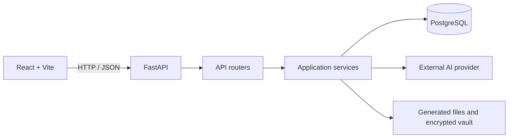

# EduAI Suite

**An AI-powered academic and career workspace** built with React/Vite and FastAPI.

[](https://github.com/Bhavani-0417/EduAI-suite/actions/workflows/ci.yml)

EduAI Suite brings academic tracking, study support, AI-assisted content creation, career preparation, and document management into one application. It is an evolving portfolio project; the presence of a module or route does not imply that every workflow has been production-hardened or fully integration-tested.

## Product areas

| Area | Functionality |
| --- | --- |
| Academic dashboard | Academic records, marks, CGPA-related views, and marksheet workflows |
| Learning hub | Notes, document extraction, summaries, and question answering |
| AI assistant | Chat workflows and voice transcription |
| Content studio | AI-assisted documents and presentations, including college-template routes |
| Career centre | Resume creation, job-description matching, application tracking, and analytics |
| Learning roadmap | Study-roadmap workflows |
| Document vault | Encrypted local file storage, OCR text extraction, and expiring share tokens |
| Code explainer | Code explanation, fixing, and review endpoints |
| College profiles | College records and template customisation |

## Architecture



## Technology

- **Frontend:** React 18, React Router, Axios, Vite
- **Backend:** Python, FastAPI, Pydantic Settings, SQLAlchemy, PostgreSQL
- **AI:** Google Gemini integration, LangChain/LangGraph, ChromaDB, SentenceTransformers
- **Documents:** PyMuPDF, OCR utilities, python-docx, python-pptx
- **Supporting integrations:** Redis and Cloudinary configuration

## Repository layout

```text
EduAI-suite/
├── backend/
│   ├── app/
│   │   ├── api/          # API routes and authentication middleware
│   │   ├── core/         # Application settings
│   │   ├── db/           # SQLAlchemy database setup
│   │   ├── models/       # ORM models
│   │   ├── schemas/      # Request and response schemas
│   │   ├── services/     # AI, academic, career, content, and vault logic
│   │   └── utils/        # Shared helpers
│   ├── scripts/        # Trusted one-off setup and data migrations
│   ├── tests/
│   └── requirements.txt
├── frontend/
│   ├── src/pages/        # Application screens
│   ├── src/services/     # API client
│   └── package.json
├── .env.example
├── docker-compose.yml
└── .github/workflows/ci.yml
```

## Run locally

### Prerequisites

- Python 3.11
- Node.js 20+ and npm
- Docker Desktop or Docker Engine with the Compose plugin
- Credentials for the external integrations you intend to use

### 1. Configure environment

From the repository root, copy the template:

```bash
cp .env.example .env
```

Windows PowerShell:

```powershell
Copy-Item .env.example .env
```

Edit `.env` before starting services. Generate separate values for `SECRET_KEY` and `JWT_SECRET_KEY` using:

```bash
python -c "import secrets; print(secrets.token_urlsafe(48))"
```

Set `POSTGRES_PASSWORD` and keep it in sync with the password in `DATABASE_URL`. Add your Google API key for Gemini-backed features and Cloudinary credentials only when using the corresponding integration. Never commit real credentials.

### 2. Start local infrastructure

```bash
docker compose up -d postgres redis
```

PostgreSQL is exposed on port `5432`; Redis is exposed on port `6379`. Compose is for local development, not production deployment.

### 3. Start the backend

```bash
cd backend
python -m venv .venv
```

Activate the environment:

```powershell
# Windows PowerShell
.\.venv\Scripts\Activate.ps1
```

```bash
# macOS / Linux
source .venv/bin/activate
```

Install dependencies and copy the root environment file into the backend working directory (settings currently read `.env` from the current working directory):

```bash
pip install -r requirements.txt
cp ../.env .env
uvicorn app.main:app --reload
```

On PowerShell use `Copy-Item ..\.env .env` for the copy command.

- API root: http://localhost:8000/
- Health endpoint: http://localhost:8000/health
- Interactive API docs: http://localhost:8000/docs

### 4. Start the frontend

In another terminal:

```bash
cd frontend
npm ci
cp .env.example .env
npm run dev
```

On PowerShell use `Copy-Item .env.example .env`. Open http://localhost:5173. The API client defaults to `http://localhost:8000`; configure `VITE_API_URL` when the backend runs elsewhere.

## Tests and quality checks

GitHub Actions runs lightweight backend unit tests, Python bytecode compilation, and a production Vite build using the committed npm lockfile.

Run backend checks from `backend/`:

```bash
python -m pytest tests -q
python -m compileall -q app scripts
```

Run the frontend build from `frontend/`:

```bash
npm ci
npm run build
```

These checks do not replace database-backed integration tests, browser tests, or a full application security review.

## Data, privacy, and security

- Use synthetic/demo accounts and files. Do not upload real identity documents, academic records, or other sensitive personal data to a public demo.
- The document vault uses Fernet authenticated encryption for files and new OCR text. Legacy plaintext OCR rows require the documented migration; the document-key derivation remains unchanged for existing encrypted files.
- New learning-note uploads use authenticated Cloudinary delivery with short-lived signed links. New note filenames, classification fields, OCR text, and summaries are Fernet-encrypted in PostgreSQL; Chroma stores encrypted note text and note IDs while retaining similarity vectors. Existing notes require the two documented migrations below. The vectors themselves remain sensitive derived data and rely on encrypted storage volumes/backups.
- Share tokens are revocable bearer links: anyone who obtains a valid, unexpired link can download that document until its owner revokes it or it expires.
- Vault uploads are limited to 10 MB and check PDF/image signatures as well as supported extensions. This is not malware scanning or complete parser validation.
- Downloads use sanitized attachment filenames and no-store cache headers. Back up the database and vault directory before migrating legacy OCR data with `python -m scripts.migrate_vault_ocr` from `backend/`.
- Generated-file download routes reject path traversal and symlink escapes. However, generated files still share one directory without owner metadata; cross-user artifact isolation remains an outstanding production requirement.
- Event and college-branding mutations are administrator-only. Voice uploads are capped at 15 MB and limited to supported audio extensions.
- Generated documents and vault uploads are runtime data. Ignore rules do not remove files already committed to Git; review those separately before deleting them or rewriting history.
- This is a portfolio/development application, not a certified document-management or production security product.

See [SECURITY.md](SECURITY.md) for data-handling notes and known limitations.

### Notes privacy migrations

Back up PostgreSQL, the Cloudinary asset inventory, and the complete `CHROMA_PERSIST_DIR` before migrating existing notes. Use the same `SECRET_KEY` that the application currently uses; changing it can make encrypted notes and vault OCR unreadable.

From `backend/`, first inspect the note-content migration without writing anything:

```bash
python -m scripts.migrate_notes_encryption
```

After checking its counts and confirming backups, apply it:

```bash
python -m scripts.migrate_notes_encryption --apply
```

This encrypts the free-text note fields in PostgreSQL and the document strings held by Chroma. It preserves existing Chroma IDs and embeddings rather than re-embedding ciphertext. Legacy chunks are linked to a note only when student ownership and the filename match uniquely; ambiguous chunks are encrypted but reported as unlinked.

Then inventory previously public Cloudinary note URLs:

```bash
python -m scripts.migrate_legacy_note_assets
```

After reviewing the inventory and confirming the database backup, run the conversion:

```bash
python -m scripts.migrate_legacy_note_assets --apply
```

The command asks you to type `MIGRATE LEGACY NOTE ASSETS`. It converts supported direct Cloudinary upload URLs to authenticated delivery, invalidates CDN caches, and updates the corresponding database locator. Unsupported/transformed URLs are reported for manual review. CDN invalidation can take a few minutes to propagate; previously cached copies may remain accessible temporarily.

Chroma similarity vectors are not ciphertext. Run Chroma and PostgreSQL on encrypted volumes, encrypt backups, restrict filesystem and database access, and keep `SECRET_KEY` out of source control. Do not use real student data on an untrusted host.

## Current limitations

Some integrations require third-party credentials and running local services. CI does not exercise every feature against a live PostgreSQL database or external AI provider. The Alembic baseline migration and hosting configuration are included, but live database migration history, encryption/data migrations, rate limiting, backups, and a full security review must be completed before using real users' records.

## Production deployment

A Render Blueprint is provided in [render.yaml](render.yaml). It defines a Docker-based FastAPI service, a static Vite frontend, PostgreSQL, and a persistent application disk. Review the compute plans and charges in Render before creating resources. EduAI stores ChromaDB indexes, generated files, and encrypted vault files locally, so those paths must use persistent storage rather than an ephemeral filesystem.

The Blueprint prompts for these secrets in Render: `GOOGLE_API_KEY`, `CLOUDINARY_CLOUD_NAME`, `CLOUDINARY_API_KEY`, and `CLOUDINARY_API_SECRET`. It generates independent `SECRET_KEY` and `JWT_SECRET_KEY` values. Never commit production credentials or paste them into issue comments.

The backend image installs Tesseract OCR and FFmpeg. The frontend is built with `VITE_API_URL` pointing to the API service. The API's `/health/ready` endpoint verifies the PostgreSQL connection.

### Database schema migrations

New databases are created with Alembic during the Render pre-deploy step. For an existing database previously initialized by SQLAlchemy `create_all`, do not run the initial migration blindly: first verify all eight application tables and their columns match the baseline, back up the database, and then mark the baseline as applied with `python -m alembic stamp 0001_initial_schema`. New installations should use `python -m alembic upgrade head`.

### Existing encrypted data

Do not run the existing notes, vault OCR, or Cloudinary asset migrations automatically during deployment. They are data migrations and require backups of PostgreSQL, the complete Chroma persistence directory, Cloudinary asset inventory, and vault files. Follow the runbooks below and retain the original `SECRET_KEY` so previously encrypted content remains readable.

## Screenshots

Add genuine screenshots or a short demo recording after running the current build. No placeholder screenshots are included.

## Contributing

Please include the affected area, setup steps, and test evidence for behavioural changes. Never include real user documents, credentials, database dumps, generated presentations, or vault contents in a pull request.
